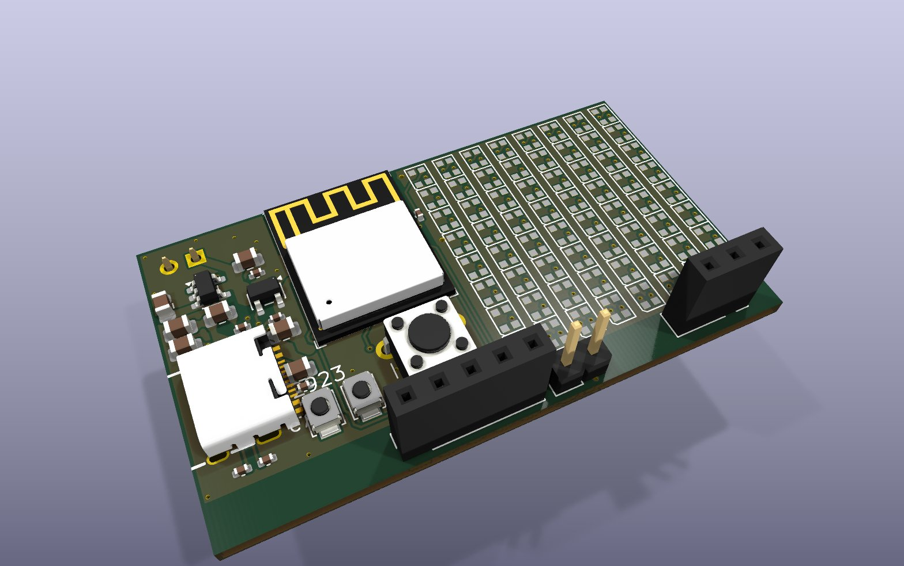

# turnie v2

ESP32-C3-MINI-1 と 64 個の WS2812B-2020（8x8）を 1 枚の基板に載せた turnie。

## ディレクトリ構成

| ディレクトリ | 内容 |
|---|---|
| `hardware/` | KiCad プロジェクト（`turnie_v2.kicad_pro`）、部品配置（`turnie_v2-all-pos.csv`） |
| `hardware/jlcpcb/` | JLCPCB に入稿したガーバーと PCBA 用ファイル |
| `hardware/*.pretty` | 自作フットプリント（EVQ-VVD00203B、サムホイール型可変抵抗） |

## ハードウェア

| 部品 | 内容 |
|---|---|
| MCU | ESP32-C3-MINI-1 |
| LED | WS2812B-2020 x 64（8x8） |
| 電源 | MIC5219-3.3（LDO）、USB-C |
| 入力 | タクトスイッチ x 3、サムホイール |

## 備考

- この版向けのファームウェアは収録していない。
- 画像は KiCad の 3D ビューから書き出したもの。
